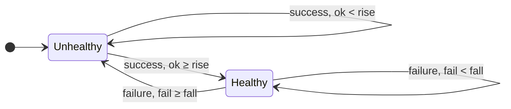
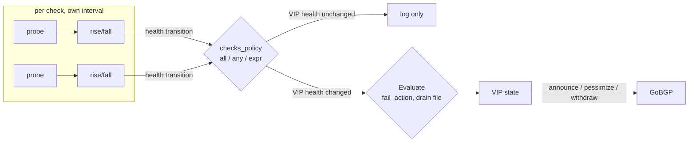
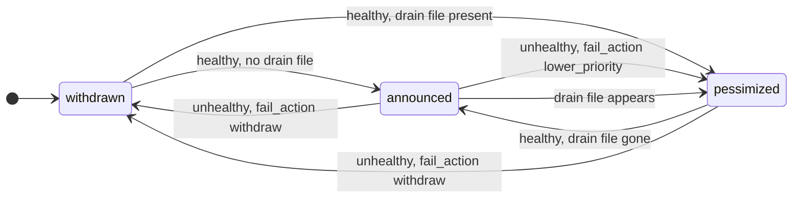

# pathosd

Health-aware BGP VIP announcer. Runs local health checks (HTTP, HTTPS, DNS, ICMP ping, TCP, UDP, gRPC, SQL, Kafka, listening socket) with HAProxy-style rise/fall hysteresis, and announces or withdraws VIP routes over BGP based on service health.

## Why pathosd?

High-availability services need a single, stable IP that fails over with the service. Classic approaches fall short:

- **Keepalived (VRRP)**: ties failover to a shared virtual MAC and requires a master/backup election. It couples the health decision to link-layer state and doesn't interoperate with routing fabrics.
- **Static VIPs**: a load balancer or router advertises a VIP unconditionally — traffic is black-holed whenever the service behind it is down.
- **Plain BGP speakers**: GoBGP/BIRD can advertise a prefix, but *you* still have to build the health-checking, hysteresis, and withdraw logic and wire it into the route originator.

`pathosd` combines the health check and the BGP originator **in one process**, so the health decision and the route state are always consistent. It is a **service route originator**, not a router: it embeds [GoBGP](https://github.com/osrg/gobgp) to advertise `/32` (or any) prefixes for Virtual IPs when the backing service is healthy, and withdraws them when it is not.

- **Fail-closed by design**: if `pathosd` dies, BGP sessions drop and every route is withdrawn. A dead health checker never leaves stale routes in the network.
- **VIPs start withdrawn**: no route is announced until the service proves healthy.
- **Single process, no IPC**: check results feed directly into route decisions. Nothing can drift out of sync.
- **Works with any BGP fabric**: peers with FRR, BIRD, or any standard BGP router — no VRRP, no shared MAC, no proprietary protocol.
- **IPv4 and IPv6**: announce IPv4 `/32` and IPv6 `/128` VIPs (or any prefix) over standard BGP/MP-BGP.
- **One moving part**: pure static binary, no sidecars, no agent to coordinate with.

## Features

- **Health checks**: HTTP/HTTPS (TLS, custom headers, response codes/text/regex/JQ, forward proxy), DNS (A/AAAA/CNAME/etc.), ICMP ping (loss ratio), TCP, UDP, gRPC (standard Health Checking Protocol + arbitrary unary methods), SQL (MySQL/MariaDB and PostgreSQL, custom queries with jq conditions), Kafka (broker metadata with TLS/SASL, optional topic leadership), listening socket (no traffic sent)
- **Rise/Fall hysteresis**: configurable consecutive success/failure thresholds before state transitions (HAProxy-style)
- **Several checks per VIP**: each with its own interval/thresholds, combined with `all`, `any` or a boolean expression such as `web || (dns && ping)`
- **Policy actions**: `withdraw` (remove route entirely) or `lower_priority` (AS-path prepend + communities), plus a `lower_priority_file` drain switch
- **Standby ordering**: per-VIP `announce.as_path_prepend` / `communities` applied while healthy, so several pathosd nodes can rank the same VIP in a fixed order over eBGP
- **IPv4 + IPv6 VIPs**: IPv6 routes are carried over IPv4-transport MP-BGP with a dedicated IPv6 next-hop
- **BGP session security**: per-neighbor TCP MD5 (`auth_password`), graceful restart, passive peers, eBGP multihop
- **Observability**: Prometheus metrics (plus GoBGP's built-in collectors), opt-in per-check-type metrics, OpenTelemetry traces/metrics/logs export, a Grafana dashboard
- **HTTP API**: landing page (`/`), `/healthz`, `/readyz`, `/status`, `/metrics`, ad-hoc check trigger
- **Optional GoBGP gRPC API**: enable for `gobgp` CLI inspection/debugging
- **YAML and TOML config** with JSON Schema validation and environment placeholders
- **Packaging**: static Linux binaries (amd64/arm64), multi-arch non-root container image, Debian package with a hardened systemd unit

## Running

### Binary

```bash
pathosd run --config /etc/pathosd/pathosd.yaml
```

Force debug logging regardless of config:

```bash
pathosd run --debug --config /etc/pathosd/pathosd.yaml
```

### Debian package

Releases include a `.deb` that installs `/usr/bin/pathosd`, a `pathosd` system user, and a systemd unit that validates and then runs `/etc/pathosd/pathosd.toml` (kept on upgrade). The unit grants only `CAP_NET_RAW` (ICMP ping) and `CAP_NET_BIND_SERVICE` (port 179) and runs with `ProtectSystem=strict`.

The unit is `Type=notify`: `systemctl start` returns once the BGP server and HTTP API are up, and `systemctl status pathosd` shows a live summary line such as `VIPs: 2 announced, 0 pessimized, 1 withdrawn; peers: 2/2 established`, refreshed on every VIP or peer transition. Under journald pathosd omits its own log timestamps, since the journal records them; `logging.timestamps` overrides the detection either way.

```bash
sudo apt install ./pathosd_<version>_amd64.deb
sudoedit /etc/pathosd/pathosd.toml
sudo systemctl enable --now pathosd
```

The host must also own the VIP addresses. [contrib/systemd/dummy-vip](contrib/systemd/dummy-vip/) holds them on a systemd-networkd `dummy` interface, one drop-in per VIP, and ships a unit drop-in so pathosd starts only once the interface is configured. Set `require_local_address: true` on the VIP to make pathosd verify this itself (see [Local Address Guard](#local-address-guard)).

### Container

The image runs as the unprivileged user `pathosd` (uid 100). The binary carries file capabilities for `CAP_NET_BIND_SERVICE` (BGP port 179) and `CAP_NET_RAW` (raw ICMP for `check.ping.privileged: true`), which the daemon raises at startup. Both are in Docker's default capability set, so the plain form works:

```bash
docker run -d \
  --name pathosd \
  --network host \
  -v /etc/pathosd:/etc/pathosd:ro \
  ghcr.io/vooon/pathosd run --config /etc/pathosd/pathosd.yaml
```

- The config directory must be readable by uid 100 (`chmod 0644` the files, or mount it with `-v ...:ro` from a world-readable path).
- With `--cap-drop ALL`, add `NET_BIND_SERVICE` back unless `bgp.listen_port: -1` (pathosd dials every peer and never listens), and `NET_RAW` only for privileged ping. A capability the container lacks is simply not raised; the daemon then fails with a clear `bind: permission denied` or `socket: operation not permitted` instead of refusing to start.
- Podman drops `NET_RAW` by default: add `--cap-add NET_RAW` for privileged ping.
- Unprivileged ping (`privileged: false`, the default) uses ICMP datagram sockets, which need the container user's gid inside `net.ipv4.ping_group_range`. Container runtimes set that sysctl to `0 0` or leave it at the host value. With a private network namespace pass `--sysctl net.ipv4.ping_group_range="0 2147483647"`; with `--network host` the host's sysctl applies, and it cannot be set per container. In containers, `privileged: true` plus `NET_RAW` is the simpler choice.
- The `listen` check reads the socket table of the container's network namespace. With `--network host` that is the host; otherwise mount `-v /proc:/host/proc:ro`, set `paths.procfs: /host/proc` and `listen.netns_pid: 1` (see [Listening Socket Check](#listening-socket-check)).
- Kubernetes: `allowPrivilegeEscalation: false` makes the kernel ignore file capabilities. Either leave it unset and keep `NET_BIND_SERVICE` / `NET_RAW` in `capabilities.add`, or run the container as root (`runAsUser: 0`) with those capabilities added.

## Configuration

Configuration uses `schema: v1` versioning. Supported formats: YAML (`.yaml`/`.yml`) and TOML (`.toml`). See [examples/pathosd.yaml](examples/pathosd.yaml) and [examples/pathosd.toml](examples/pathosd.toml) for complete, commented examples.

### Validation and JSON Schema

Validate a config file without starting the daemon:

```bash
pathosd validate --config /etc/pathosd/pathosd.yaml
```

A JSON Schema is provided at `schema/pathosd-config-v1.schema.json` for editor autocompletion and validation. It is generated from the Go config structs (`go generate ./internal/config/...`), so every field and default is documented there.

### Environment Placeholders

Config values can reference environment variables using VictoriaMetrics-style placeholders:

```yaml
router:
  router_id: "%{POD_IP}"
  local_address: "%{PATHOSD_LOCAL_IP}"
  local_address_ipv6: "%{PATHOSD_LOCAL_IPV6}"
bgp:
  listen_address: "%{PATHOSD_LISTEN_IP}"
  listen_port: 1179
  gobgp_api:
    enabled: true
    listen: "%{PATHOSD_GOBGP_API_LISTEN}"
  neighbors:
    - name: frr
      address: "%{FRR_PEER_IP}"
      local_address: "%{PATHOSD_LOCAL_IP}"
      auth_password: "%{PATHOSD_BGP_MD5}"
```

- `%{VAR_NAME}`: replaces with the value of `VAR_NAME` from the process environment.
- `%%{VAR_NAME}`: escapes the pattern and keeps it as literal `%{VAR_NAME}`.
- If any referenced variable is missing, startup fails with a clear error listing missing names.
- Expansion runs on the raw file before parsing, so a placeholder inside a comment is expanded (and must resolve) too.

### Key Config Rules

- `check.timeout` must be strictly less than `check.interval` (defaults: `interval: 1s`, `timeout: 100ms`)
- `rise` and `fall` must be ≥ 1 (defaults: `rise: 1`, `fall: 3`)
- Exactly one of `check` or `checks` per VIP; check names must be unique within the VIP (two checks of the same type need explicit names) and `checks_policy` must compile against them
- Each VIP name and prefix must be unique
- At least one neighbor and one VIP are required
- `policy.lower_priority` (`as_path_prepend`, default 6; `communities`) is used whenever the VIP is announced pessimized: on check failure with `fail_action: lower_priority`, and whenever `lower_priority_file` exists, regardless of `fail_action`
- Any IPv6 VIP prefix requires `router.local_address_ipv6` (used as the IPv6 next-hop); the `router_id` stays IPv4

## Health Checks

Each check type has its own guide with examples from the smallest config to production setups: [docs/checks/](https://github.com/vooon/pathosd/blob/main/docs/checks/README.md) (`http`, `dns`, `ping`, `tcp`, `udp`, `grpc`, `listen`, `sql`, `kafka`). There is deliberately no `exec` check and no embedded scripting; [docs/design/no-exec-no-scripting.md](https://github.com/vooon/pathosd/blob/main/docs/design/no-exec-no-scripting.md) explains why and what to use instead.

### Rise/Fall

- **Fall**: number of consecutive failures before a healthy check transitions to unhealthy
- **Rise**: number of consecutive successes before an unhealthy check transitions to healthy
- VIPs always start in the **withdrawn** state — they must pass `rise` consecutive checks before being announced

Every check runs on its own loop (first probe at startup, then every `interval`) and keeps its own counters. A failure resets the success counter and vice versa, so the thresholds count strictly consecutive results:



Only the two crossing edges emit a *health transition* to the policy layer; everything else is a counter update visible in `/status` as `consecutive_ok` / `consecutive_fail`.

### From Check Result to BGP Update

A transition travels synchronously through the policy manager: the combined health is recomputed, the VIP state is derived from it together with `fail_action` and the drain file, and the BGP update (if any) is sent in the same call. There is no extra VIP-level timer.



The VIP state itself has three values. `pessimized` is reachable from both sides: on failure with `fail_action: lower_priority`, and while the `lower_priority_file` exists even though the checks pass.



### Multiple Checks per VIP

`checks` replaces the single `check` with a list. Every entry is a complete check with its own type, interval, timeout, rise and fall, so a slow TLS probe and a fast TCP probe can coexist. `checks_policy` decides how the per-check health (after each check's own rise/fall) becomes the VIP health:

| `checks_policy` | VIP is healthy when |
|-----------------|---------------------|
| `all` (default) | every check is healthy |
| `any` | at least one check is healthy |
| expression | the expression over the check names is true, e.g. `web || (dns && ping)` |

```yaml
vips:
  - name: web
    prefix: 10.10.1.1/32
    checks_policy: "web || (dns && ping)"
    checks:
      - name: web            # names default to the type; required when a type repeats
        type: http
        http: { url: https://web.example.com/healthz }
      - type: dns
        interval: 10s
        timeout: 2s
        dns: { names: ["web.example.com."] }
      - type: ping
        ping: {}
    policy:
      fail_action: withdraw
```

Expressions use [expr-lang](https://expr-lang.org/docs/language-definition) syntax with the check names as booleans: `&&`/`and`, `||`/`or`, `!`/`not` and parentheses. They are compiled at config load, so a misspelled or unknown check name, or an expression that is not boolean, is a validation error rather than a VIP that never announces. Check names are identifiers (`[A-Za-z_][A-Za-z0-9_]*`); `all` and `any` are reserved. A check that has not reported yet counts as unhealthy, so with `all` the VIP waits for the slowest `rise`.

A check transition that does not change the combined health is logged (`check transition without VIP health change`) but causes no BGP update. `/status` lists every check under `checks` with its own health, counters and last detail; `last_transition_reason` is prefixed with the check name. The `pathosd_check_*` metrics carry a `check` label.

#### Reaction time

Each check reacts in a fixed time: failure is detected after about `fall × interval` (plus at most one `timeout` for the last probe), recovery after `rise × interval`. The policy decides which check's time the VIP follows:

| `checks_policy` | VIP withdraws / pessimizes after | VIP announces after |
|-----------------|----------------------------------|---------------------|
| `all` | the **fastest** failing check: min of `fall × interval` | the **slowest** check: max of `rise × interval` |
| `any` | the **last** healthy check fails: max of `fall × interval` | the **fastest** check: min of `rise × interval` |
| expression | whichever check flips the expression, same per-check arithmetic | same |

With the example above (`web` 1 s × fall 3, `dns` 10 s × fall 3, `ping` 1 s × fall 3) and `web || (dns && ping)`: web and ping both dying withdraws the VIP about 3 s later; a dns outage alone needs about 30 s to register and withdraws nothing while web is healthy. On startup `all` announces only after the slowest check reaches its `rise`, since a check that has never reported counts as unhealthy.

```mermaid
gantt
    title all(web, dns): backend dies at t=0, web 1s × fall 3, dns 10s × fall 3
    dateFormat ss
    axisFormat %Ss
    section web
    probe fails (1/3)     :w1, 00, 1s
    probe fails (2/3)     :w2, after w1, 1s
    probe fails (3/3) → unhealthy :crit, w3, after w2, 1s
    section dns
    probe fails (1/3)     :d1, 00, 10s
    probe fails (2/3)     :d2, after d1, 10s
    probe fails (3/3) → unhealthy :d3, after d2, 10s
    section VIP
    announced             :v1, 00, 3s
    withdrawn (web settled all) :crit, v2, after v1, 27s
```



Under `any` the same outage would keep the VIP announced until the dns check settles at about 30 s.

### Ad-Hoc Check Trigger

`pathosd check` runs the configured checks once, without BGP or the daemon, and prints each check's result and the combined VIP health. Use it to try a config before deploying, to debug a withdrawn VIP from a shell, or from a cron job. It exits non-zero when any selected VIP is unhealthy.

```bash
pathosd check --config /etc/pathosd/pathosd.toml                     # every VIP
pathosd check --config pathosd.yaml --vip web --check http           # one check of one VIP
pathosd check --config pathosd.yaml --format json --timeout 5s       # JSON with type-specific details
```

```
VIP web (10.10.1.1/32): healthy [http || tcp]
  OK    http  http  12.4ms  HTTP 200 OK
  FAIL  tcp   tcp   1.1ms   dial tcp 10.10.1.1:443: connect: connection refused
```

`--check` runs only the named checks; the others count as failed in the combination, exactly like `?check=` on the API. `--skip-local-address` runs the probes even when `require_local_address` would hold them back on this host. Exit codes follow `test(1)`: `0` every selected VIP is healthy, `1` at least one is unhealthy. Internal errors (missing or invalid config, unknown VIP or check name) exit `200`, above the range a health verdict or a signal could produce. A malformed command line exits `80` (kong's usage error), as for every subcommand.

For VIPs with long check intervals on a running daemon, trigger an immediate check through the API:

```bash
curl -X POST http://127.0.0.1:59179/api/v1/vips/web-frontend/check
```

The result feeds into the normal rise/fall state machine — it does not bypass hysteresis. The response carries the check result including type-specific details (status code, RTTs, rcode, …). For a VIP with several checks all of them run; `results` holds each check's result by name and `result` the combination under `checks_policy`. `?check=<name>` runs only that check (the others count as failed in the combined `result`).

### Local Address Guard

A route for an address the host does not own black-holes traffic. With `require_local_address: true` the check fails, with an explicit detail and a warning log, while the VIP address is not configured on a local interface; the real check only runs once it is. `local_interface` narrows it to one interface:

```yaml
vips:
  - name: web
    prefix: 10.10.1.1/32
    require_local_address: true
    local_interface: dummy-vip   # optional: any interface when omitted
    check: { type: http, http: { url: https://web.example.com/healthz } }
```

The result goes through the normal rise/fall hysteresis, so removing the address withdraws the route after `fall` checks and adding it back announces after `rise`. `pathosd_vip_local_address_assigned{vip}` exports the state for alerting.

### SQL Check

The `sql` check connects to MySQL/MariaDB (`driver: mysql`) or PostgreSQL (`driver: postgres`) and runs a list of queries on one connection. Every query must succeed; a query with `result_jq` additionally has to make the expression true when evaluated against its rows as a JSON array of `{column: value}` objects. Numeric columns arrive as numbers, booleans as booleans (MySQL: 0/1), timestamps as RFC 3339 strings, `NULL` as `null`, and everything else as strings (PostgreSQL arrays and `jsonb` too; use jq's `fromjson` on the latter). Nothing database-specific is built in, so replication lag, read-only state or an application table are all a query plus a condition:

```yaml
vips:
  - name: mariadb
    prefix: 10.10.8.1/32
    check:
      type: sql
      interval: 5s
      timeout: 2s
      sql:
        driver: mysql                 # mysql | postgres (port defaults to 3306 / 5432)
        user: pathosd
        password: "%{DB_PASSWORD}"    # from the environment, never a literal
        queries:
          - sql: SELECT 1
          - name: writable
            sql: SELECT @@read_only AS read_only
            result_jq: ".[0].read_only == 0"
          - name: replica_lag
            sql: SHOW REPLICA STATUS
            result_jq: ".[0].Seconds_Behind_Source < 60"
```

```yaml
      sql:
        driver: postgres
        user: pathosd
        password: "%{DB_PASSWORD}"
        database: app
        queries:
          - name: primary
            sql: SELECT pg_is_in_recovery() AS in_recovery
            result_jq: ".[0].in_recovery == false"
          - name: replica_lag          # on a standby instead
            sql: SELECT EXTRACT(EPOCH FROM now() - pg_last_xact_replay_timestamp()) AS lag
            result_jq: ".[0].lag < 60"
```

Only the rows (bounded by `max_rows`, default 100) are inspected, the SQL text is not interpreted, and the user only needs the privileges the queries require. By default every check opens a fresh connection and closes it afterwards, so authentication is exercised each time; `keep_alive: true` reuses it. `tls`, `tls_ca_cert`, `tls_insecure` and `tls_server_name` work as for the HTTP check. With `detailed_metrics` the check exports `pathosd_sql_query_passed`, `pathosd_sql_query_rows` and `pathosd_sql_query_duration_seconds` per query name. The ad-hoc trigger response lists every query with its row count and outcome; queries after a failing one are not run.

### Kafka Check

The `kafka` check opens a client connection to one broker, negotiates API versions (and TLS and SASL when configured) and requests cluster metadata. It passes when the broker answers with at least `min_brokers` brokers (default 1) and, if `topic` is set, that topic exists with a leader for every partition. Without `topic` only broker metadata is requested, which stays cheap on large clusters.

```yaml
vips:
  - name: kafka
    prefix: 10.10.9.1/32
    check:
      type: kafka
      interval: 5s
      timeout: 3s
      kafka:
        port: 9092                  # host defaults to the VIP IP
        # tls: true
        # tls_ca_cert: /etc/pathosd/kafka-ca.crt
        sasl:
          mechanism: scram-sha-512  # plain | scram-sha-256 | scram-sha-512
          user: pathosd
          password: "%{KAFKA_PASSWORD}"
        topic: events               # optional: must exist with a leader per partition
        min_brokers: 3              # optional: metadata must list this many brokers
```

The check opens a fresh connection every run, so authentication is exercised each time; `client_id` (default `pathosd`) is what the broker logs and applies quotas to. With `detailed_metrics` the check exports `pathosd_kafka_brokers` and `pathosd_kafka_partitions_without_leader`; the trigger response carries the cluster ID, controller, broker count and partition counts.

### Listening Socket Check

Some services log or alert on every unexpected datagram (IPFIX/NetFlow collectors, syslog, SNMP traps), which makes the `udp` probe noisy. The `listen` check sends nothing: it reads the kernel socket tables (`/proc/net/tcp`, `tcp6`, `udp`, `udp6`) and passes when a socket is bound to the port, a TCP socket in `LISTEN` state or any bound UDP socket. A wildcard bind (`0.0.0.0`, `::`) satisfies any `host`.

```yaml
vips:
  - name: ipfix
    prefix: 10.10.7.1/32
    check:
      type: listen
      listen:
        proto: udp     # tcp | udp
        port: 4739
        # host: 10.10.7.1   # default: the VIP address; wildcard binds match too
```

It proves a process holds the port, not that it answers, so pair it with a real probe where one exists (`checks` + `checks_policy`). Linux only. With `detailed_metrics` it exports `pathosd_listen_sockets` (number of matching sockets).

The socket tables are per network namespace (`/proc/net` is `/proc/self/net`), so by default the check sees the namespace pathosd runs in: every service on a host or with `--network host` / `hostNetwork`. A container with its own network namespace reads the host's table node-exporter style, by mounting the host's `/proc` and naming a host process whose namespace to use (pid 1 is the host's init):

```yaml
paths:
  procfs: /host/proc        # docker run -v /proc:/host/proc:ro ...
vips:
  - name: ipfix
    check:
      type: listen
      listen: { proto: udp, port: 4739, netns_pid: 1 }
```

`netns_pid` reads `<procfs>/<pid>/net/*`; the host's `/proc/net` itself would again resolve to the container's own namespace. Reading another process's `net/` needs no capability.

### HTTP Check Connections

By default every HTTP check opens a new TCP (and TLS) connection, so each run exercises the full path including certificate verification. Set `http.keep_alive: true` to reuse the connection across checks; this saves the handshake on fast intervals, but the certificate is then only re-verified when the idle connection is dropped (after 90s idle, or when the server closes it).

## Announce Policy and Standby Ordering

Each VIP has two attribute sets under `policy`:

| Block | When applied | `as_path_prepend` | `communities` |
|-------|--------------|-------------------|---------------|
| `announce` | every announcement (healthy and pessimized) | 0–16, default 0 | attached always |
| `lower_priority` | only while pessimized (check failed with `fail_action: lower_priority`, or `lower_priority_file` present) | 1–16, default 6, **added** to the `announce` value | **merged** with the `announce` list |

Use `announce.as_path_prepend` to rank nodes announcing the same VIP: a primary with `0`, a standby with `4`, and so on. Because the pessimized prepend is the sum of both blocks, a degraded primary (`0 + 6 = 6`) still ranks below a healthy standby (`4`), and a degraded standby (`4 + 6 = 10`) ranks below a degraded primary — the standby order never inverts.

```yaml
vips:
  - name: web
    prefix: 10.10.1.1/32
    check: { type: http }
    policy:
      fail_action: lower_priority
      announce:
        as_path_prepend: 4          # this node is the standby
        communities: ["65001:200"]  # tag every announcement
      lower_priority:
        as_path_prepend: 6          # pessimized: 4 + 6 = 10 prepends
        communities: ["65001:666"]  # pessimized: 65001:200 + 65001:666
```

Prepends only work over eBGP: for iBGP peers pathosd never prepends the local ASN (a warning is logged when a prepend would have applied). Communities are sent on both.

`pathosd_vip_priority_status` reports the prepend count currently applied to the VIP (`0` means full priority), and `/status` exposes `as_path_prepend_base`, `as_path_prepend` (effective) and `communities` per VIP.

## BGP Peering

### Session Authentication (TCP MD5)

BGP has no TLS. The deployed protections are TCP MD5 signatures (RFC 2385), its successor TCP-AO (RFC 5925, not yet supported by GoBGP) and GTSM/TTL security (RFC 5082). pathosd supports TCP MD5 per neighbor via `auth_password`: the kernel signs and verifies every segment, so a host that does not know the key cannot open, hijack or reset the session.

```yaml
bgp:
  neighbors:
    - name: frr
      address: 10.0.0.2
      peer_asn: 65000
      auth_password: "%{PATHOSD_BGP_MD5}"   # keep the secret in the environment
```

The same key goes on the peer: `neighbor 10.0.0.1 password ...` in FRR, or `password "...";` inside the `protocol bgp` block in BIRD. Keys are at most 80 bytes (Linux `TCP_MD5SIG_MAXKEYLEN`). Setting the socket option needs no capability.

Two consequences worth knowing:

- Once a port is MD5-protected, an unsigned TCP connect to it (a `tcpSocket` readiness probe, `nc -z`, a port scanner) is silently dropped by the kernel. Monitor the session through the daemon, not by poking port 179.
- The embedded GoBGP gRPC API (`bgp.gobgp_api`) returns the password as part of the peer configuration, so keep that API on a local address or unix socket.

### OpenWrt/BIRD Localhost Peering

On OpenWrt the mesh routers run BIRD, and pathosd lives on the same host. pathosd acts as a distinct ASN and announces anycast VIPs over a local eBGP session. The session is passive on pathosd's side: BIRD dials out to pathosd on a second IP that BIRD assigns to its own LAN interface, at port `1179`.

Corresponding pathosd config:

```yaml
router:
  local_address: "<pathosd-local-ip>"
bgp:
  listen_address: <pathosd-listen-ip>
  listen_port: 1179
  neighbors:
    - name: bird-local
      address: <bird-local-ip>
      peer_asn: <bird_as>
      passive: true
      required: true
```

BIRD-side config for the local pathosd peer:

```bird
protocol bgp peer_pathosd_local {
    local <bird-local-ip> as <bird_as>;
    neighbor <pathosd-listen-ip> port 1179 as <pathosd_as>;
    multihop;
    ipv4 {
        import filter {
            if net ~ [ <vip>/32, ... ] then {
                bgp_next_hop = net.ip;
                preference = 250;
                accept;
            }
            reject;
        };
        export none;
    };
}
```

The import filter above is the critical part. pathosd announces VIP routes with `router.local_address` (the router's own address) as next-hop. BIRD refuses to install a route whose next-hop is a local address ("Next hop address X is a local address of iface"), so a naive `import all` would leave the route unreachable and never selected. The fix is done entirely in the filter:

1. Restrict imports to the VIP prefixes only (`if net ~ [ <vip>/32, ... ]`).
2. Rewrite each VIP's next-hop to the VIP itself (`bgp_next_hop = net.ip`) so the route is resolvable via the connected `dummy_vip`.
3. Raise `preference = 250`, above the connected/device route's default of `240`, so BIRD selects pathosd's route over the connected VIP route.
4. Reject everything else.

BIRD still marks the route unreachable locally (the next-hop caveat), but it selects and exports it to eBGP mesh peers — so the VIP reaches the mesh.

Pessimization: pathosd's `fail_action: lower_priority` with `as_path_prepend` propagates through BIRD to the mesh — remote routers see a longer AS path and steer away. This works directly over eBGP, so no iBGP or communities are required.

### GoBGP CLI Debugging

Enable the embedded GoBGP gRPC API when you want to inspect live state with the `gobgp` CLI:

```yaml
bgp:
  gobgp_api:
    enabled: true
    # Optional, defaults to 127.0.0.1:50051 when enabled.
    listen: 127.0.0.1:50051
```

Then query it with:

```bash
gobgp -u 127.0.0.1:50051 neighbor
gobgp -u 127.0.0.1:50051 global rib
```

## HTTP API

| Endpoint | Method | Description |
|----------|--------|-------------|
| `/` | GET | HTML status page: VIPs with state, health, every check with its health and last detail, peers with session state, a trigger-check button per VIP |
| `/healthz` | GET | Liveness — 200 if process is running |
| `/readyz` | GET | Readiness — 200 if all required BGP peers are established |
| `/status` | GET | Full daemon state: peers, VIPs, last check results |
| `/metrics` | GET | Prometheus metrics exposition |
| `/api/v1/vips/{name}/check` | POST | Trigger ad-hoc health check(s); `?check=<name>` runs a single check of the VIP |

### Readiness vs Liveness

- **`/healthz`** returns 200 as long as the process is up and config is loaded. It does NOT depend on BGP peer state.
- **`/readyz`** returns 200 only when all `required: true` BGP peers have established sessions. Returns 503 with a JSON body listing unready peers otherwise.

### API Security

The HTTP API has no authentication. Bind it to a loopback or host-local address (`api.listen`; the examples use `127.0.0.1:59179`, the built-in default `:59179` listens on every interface) and let Prometheus scrape it from there. If it must be reachable from other hosts, front it with a reverse proxy or a firewall rule.

What an unauthenticated client can do:

- **Read state**: `/status`, `/readyz` and `/metrics` expose peer addresses, ASNs, VIP prefixes and the last check result of every VIP. Treat that as internal topology information.
- **Trigger a check**: `POST /api/v1/vips/{name}/check` runs the configured check once. It cannot change the target, the request, or the route: the result goes through the normal rise/fall hysteresis, and checks for one VIP are serialized, so at most one ad-hoc check per VIP is in flight. The only effect of hammering the endpoint is that `fall` (or `rise`) is reached as fast as the backend answers instead of once per `interval`. Each trigger is logged with the caller's address.

The server applies `api.read_header_timeout`, `read_timeout`, `write_timeout` and `idle_timeout` (defaults 10s / 30s / 60s / 120s, `0` disables) so slow or idle clients cannot pin connections. `write_timeout` must exceed the longest `check.timeout` for the trigger endpoint to return a result.

## Observability

### Metrics

`/metrics` always carries the VIP state, transition, priority, route-state and check counters/histograms (`pathosd_vip_*`, `pathosd_route_state`, `pathosd_check_*`) plus GoBGP's own collectors (`bgp_peer_*`, `bgp_routes_*`, message counters). The check series are labelled `vip`, `nlri` and `check` (the check name, which is the type unless set). Per-check-type details are opt-in per check with `detailed_metrics: true`, because they add series per check (and per name for DNS):

| Check | Metric | Meaning |
|-------|--------|---------|
| ping | `pathosd_ping_rtt_seconds` (histogram) | RTT of each echo reply |
| ping | `pathosd_ping_packet_loss_ratio` | loss of the last run, 0..1 |
| http | `pathosd_http_response_status` | status code of the last response |
| http | `pathosd_http_tls_cert_expiry_timestamp_seconds` | `NotAfter` of the leaf certificate (HTTPS only) |
| dns | `pathosd_dns_rcode{name}` | rcode of the last reply, 0 = NOERROR |
| dns | `pathosd_dns_answers{name}` | answer records in the last reply |
| grpc | `pathosd_grpc_status_code` | status code of the last call, 0 = OK |
| listen | `pathosd_listen_sockets` | sockets bound to the checked port in the last run |
| sql | `pathosd_sql_query_passed{query}` | 1 when the query succeeded and its `result_jq` held |
| sql | `pathosd_sql_query_rows{query}` | rows returned by the query |
| sql | `pathosd_sql_query_duration_seconds{query}` | duration of the query in the last run |
| kafka | `pathosd_kafka_brokers` | brokers listed in the metadata of the last run |
| kafka | `pathosd_kafka_partitions_without_leader` | partitions of the configured topic without a leader |

VIPs with `require_local_address` additionally export `pathosd_vip_local_address_assigned` (1 while the address is configured on the host).

The same details are returned in the `result.details` object of the ad-hoc check trigger regardless of the flag.

### Grafana Dashboard

[contrib/grafana/pathosd.json](contrib/grafana/pathosd.json) is an importable dashboard (Grafana 11+, Prometheus-compatible datasource) with rows for VIP state, routes, health checks, the GoBGP session, and a collapsed row for the opt-in per-check details. Import it via *Dashboards → New → Import* and pick your datasource; the `instance` and `vip` variables filter every panel.

### OpenTelemetry Export

Set `otel.endpoint` to an OTLP collector to export traces, metrics (bridged from the Prometheus registry) and logs. The URL scheme selects the transport: `grpc://` / `grpcs://` for OTLP/gRPC, `http://` / `https://` for OTLP/HTTP. Each signal can override the endpoint, headers, TLS setting or be disabled individually under `otel.traces`, `otel.metrics` and `otel.logs`; `logging.otel_level` sets a separate minimum level for exported logs.

```yaml
otel:
  endpoint: grpc://otel-collector.example.com:4317
  service_name: pathosd
  # headers: { x-honeycomb-team: "%{HONEYCOMB_KEY}" }
  # traces: { enabled: false }
```

Every health check runs as a trace span; the BGP announce, pessimize or withdraw it causes appears as a child span, so a route change can be followed back to the check result that triggered it.

## Troubleshooting

See [docs/troubleshooting.md](docs/troubleshooting.md): what `/status` and the logs tell you, peers that never establish (including silent TCP MD5 mismatches), VIPs that stay withdrawn, routes the peer rejects, pessimization on iBGP, flapping, and empty metrics.

## Development

### Building

```bash
make build                             # static binary via go build
goreleaser build --snapshot --clean    # all release targets
docker build -t pathosd .              # container image
```

### Checks Before a PR

```bash
go build ./...
go vet -tags e2e ./...
golangci-lint run
go test -race ./...
go generate ./internal/config/... && git diff --exit-code schema/
```

CI runs the same plus `go mod tidy -diff` and `govulncheck`.

### E2E Testing

End-to-end tests run pathosd with FRR, BIRD, nginx, CoreDNS, etcd, squid and syslog inside k3d/k3s and validate announce, pessimization, and withdraw behavior across all check types, including an MD5-signed session to FRR.

- Test code: `tests/e2e/e2e_test.go` (`//go:build e2e`)
- Manifests: `tests/e2e/manifests/`
- Design notes: `docs/e2e-test-design.md`

Run locally:

```bash
make e2e
```

Or step-by-step:

```bash
make e2e-cluster
make e2e-build
make e2e-deploy
make e2e-test
```

## Version

```bash
pathosd --version
```

Build version, commit, and date are injected via ldflags at build time.

## License

See [LICENSE](LICENSE).
