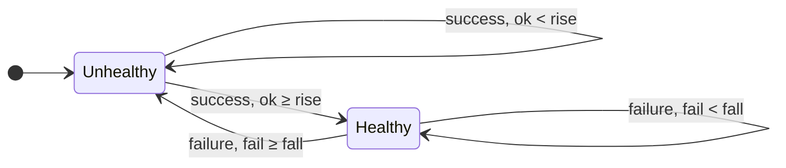
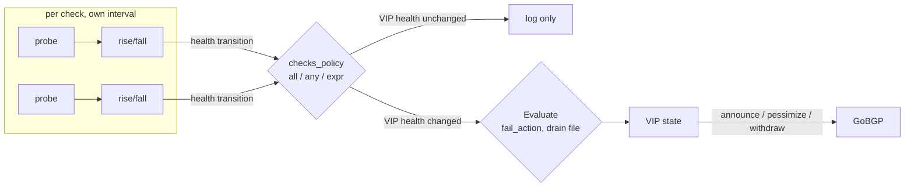
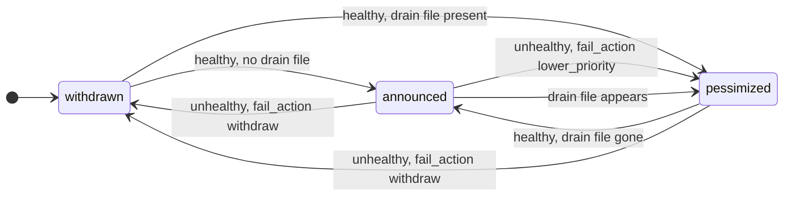

# Health Checks

Each check type has its own guide with examples from the smallest config to production setups: [docs/checks/](https://github.com/vooon/pathosd/blob/main/docs/checks/README.md) (`http`, `dns`, `ping`, `tcp`, `udp`, `grpc`, `listen`, `sql`, `kafka`). There is deliberately no `exec` check and no embedded scripting; [docs/design/no-exec-no-scripting.md](https://github.com/vooon/pathosd/blob/main/docs/design/no-exec-no-scripting.md) explains why and what to use instead.

This page covers what is common to every check type: hysteresis, how a result becomes a route change, combining several checks, the local address guard, and running checks on demand.

## Rise/Fall

- **Fall**: number of consecutive failures before a healthy check transitions to unhealthy
- **Rise**: number of consecutive successes before an unhealthy check transitions to healthy
- VIPs always start in the **withdrawn** state — they must pass `rise` consecutive checks before being announced

Every check runs on its own loop (first probe at startup, then every `interval`) and keeps its own counters. A failure resets the success counter and vice versa, so the thresholds count strictly consecutive results:



Only the two crossing edges emit a *health transition* to the policy layer; everything else is a counter update visible in `/status` as `consecutive_ok` / `consecutive_fail`.

## From check result to BGP update

A transition travels synchronously through the policy manager: the combined health is recomputed, the VIP state is derived from it together with `fail_action` and the drain file, and the BGP update (if any) is sent in the same call. There is no extra VIP-level timer.



The VIP state itself has three values. `pessimized` is reachable from both sides: on failure with `fail_action: lower_priority`, and while the `lower_priority_file` exists even though the checks pass.



## Multiple checks per VIP

`checks` replaces the single `check` with a list. Every entry is a complete check with its own type, interval, timeout, rise and fall, so a slow TLS probe and a fast TCP probe can coexist. `checks_policy` decides how the per-check health (after each check's own rise/fall) becomes the VIP health:

| `checks_policy` | VIP is healthy when |
|-----------------|---------------------|
| `all` (default) | every check is healthy |
| `any` | at least one check is healthy |
| expression | the expression over the check names is true, e.g. `web || (dns && ping)` |

```yaml
vips:
  - name: web
    prefix: 10.10.1.1/32
    checks_policy: "web || (dns && ping)"
    checks:
      - name: web            # names default to the type; required when a type repeats
        type: http
        http: { url: https://web.example.com/healthz }
      - type: dns
        interval: 10s
        timeout: 2s
        dns: { names: ["web.example.com."] }
      - type: ping
        ping: {}
    policy:
      fail_action: withdraw
```

Expressions use [expr-lang](https://expr-lang.org/docs/language-definition) syntax with the check names as booleans: `&&`/`and`, `||`/`or`, `!`/`not` and parentheses. They are compiled at config load, so a misspelled or unknown check name, or an expression that is not boolean, is a validation error rather than a VIP that never announces. Check names are identifiers (`[A-Za-z_][A-Za-z0-9_]*`); `all` and `any` are reserved. A check that has not reported yet counts as unhealthy, so with `all` the VIP waits for the slowest `rise`.

A check transition that does not change the combined health is logged (`check transition without VIP health change`) but causes no BGP update. `/status` lists every check under `checks` with its own health, counters and last detail; `last_transition_reason` is prefixed with the check name. The `pathosd_check_*` metrics carry a `check` label.

### Reaction time

Each check reacts in a fixed time: failure is detected after about `fall × interval` (plus at most one `timeout` for the last probe), recovery after `rise × interval`. The policy decides which check's time the VIP follows:

| `checks_policy` | VIP withdraws / pessimizes after | VIP announces after |
|-----------------|----------------------------------|---------------------|
| `all` | the **fastest** failing check: min of `fall × interval` | the **slowest** check: max of `rise × interval` |
| `any` | the **last** healthy check fails: max of `fall × interval` | the **fastest** check: min of `rise × interval` |
| expression | whichever check flips the expression, same per-check arithmetic | same |

With the example above (`web` 1 s × fall 3, `dns` 10 s × fall 3, `ping` 1 s × fall 3) and `web || (dns && ping)`: web and ping both dying withdraws the VIP about 3 s later; a dns outage alone needs about 30 s to register and withdraws nothing while web is healthy. On startup `all` announces only after the slowest check reaches its `rise`, since a check that has never reported counts as unhealthy.

```mermaid
gantt
    title all(web, dns): backend dies at t=0, web 1s × fall 3, dns 10s × fall 3
    dateFormat ss
    axisFormat %Ss
    section web
    probe fails (1/3)     :w1, 00, 1s
    probe fails (2/3)     :w2, after w1, 1s
    probe fails (3/3) → unhealthy :crit, w3, after w2, 1s
    section dns
    probe fails (1/3)     :d1, 00, 10s
    probe fails (2/3)     :d2, after d1, 10s
    probe fails (3/3) → unhealthy :d3, after d2, 10s
    section VIP
    announced             :v1, 00, 3s
    withdrawn (web settled all) :crit, v2, after v1, 27s
```



Under `any` the same outage would keep the VIP announced until the dns check settles at about 30 s.

## Local address guard

A route for an address the host does not own black-holes traffic. With `require_local_address: true` the check fails, with an explicit detail and a warning log, while the VIP address is not configured on a local interface; the real check only runs once it is. `local_interface` narrows it to one interface:

```yaml
vips:
  - name: web
    prefix: 10.10.1.1/32
    require_local_address: true
    local_interface: dummy-vip   # optional: any interface when omitted
    check: { type: http, http: { url: https://web.example.com/healthz } }
```

The result goes through the normal rise/fall hysteresis, so removing the address withdraws the route after `fall` checks and adding it back announces after `rise`. `pathosd_vip_local_address_assigned{vip}` exports the state for alerting.

## Running checks on demand

Two ways, with different semantics:

- `pathosd check --config FILE` runs the configured checks once from a shell, with no daemon and no BGP, and prints each result and the combined VIP health. It applies no rise/fall. Exit codes follow `test(1)`: `0` healthy, `1` unhealthy, `200` on a config or usage error. Details and flags in [CLI](https://github.com/vooon/pathosd/blob/main/docs/cli.md#check).
- `POST /api/v1/vips/<name>/check` asks a running daemon for an immediate probe, useful for VIPs with long intervals:

```bash
curl -X POST http://127.0.0.1:59179/api/v1/vips/web-frontend/check
```

The API result feeds into the normal rise/fall state machine; it does not bypass hysteresis. The response carries the check result including type-specific details (status code, RTTs, rcode, …). For a VIP with several checks all of them run; `results` holds each check's result by name and `result` the combination under `checks_policy`. `?check=<name>` runs only that check (the others count as failed in the combined `result`).
